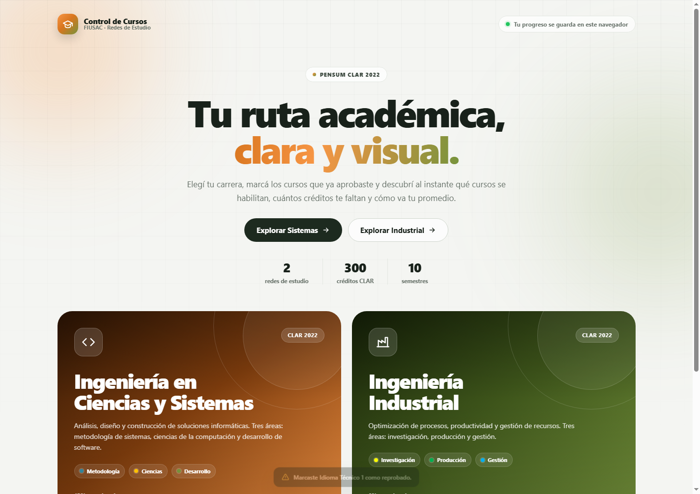
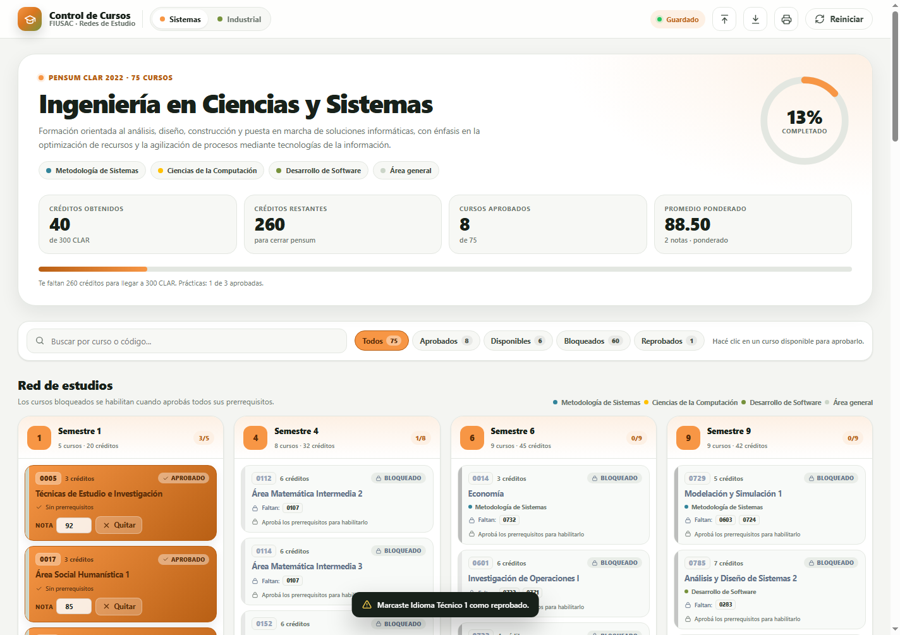
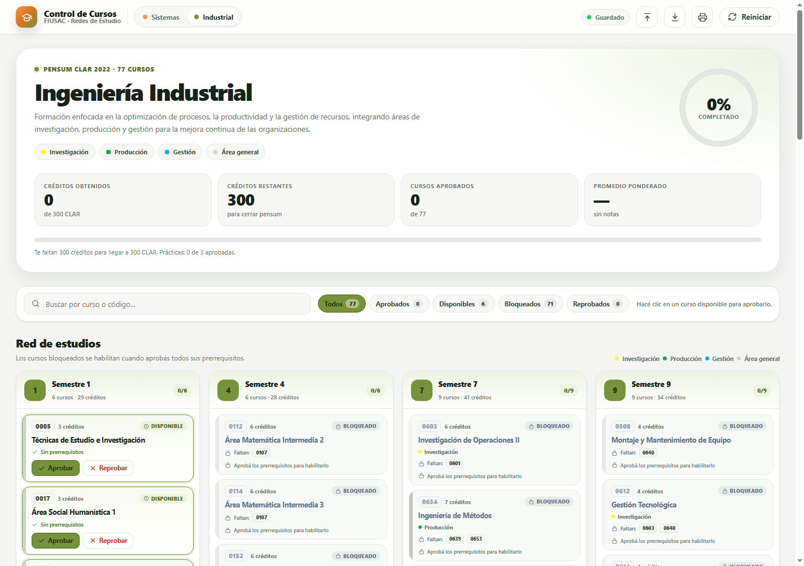
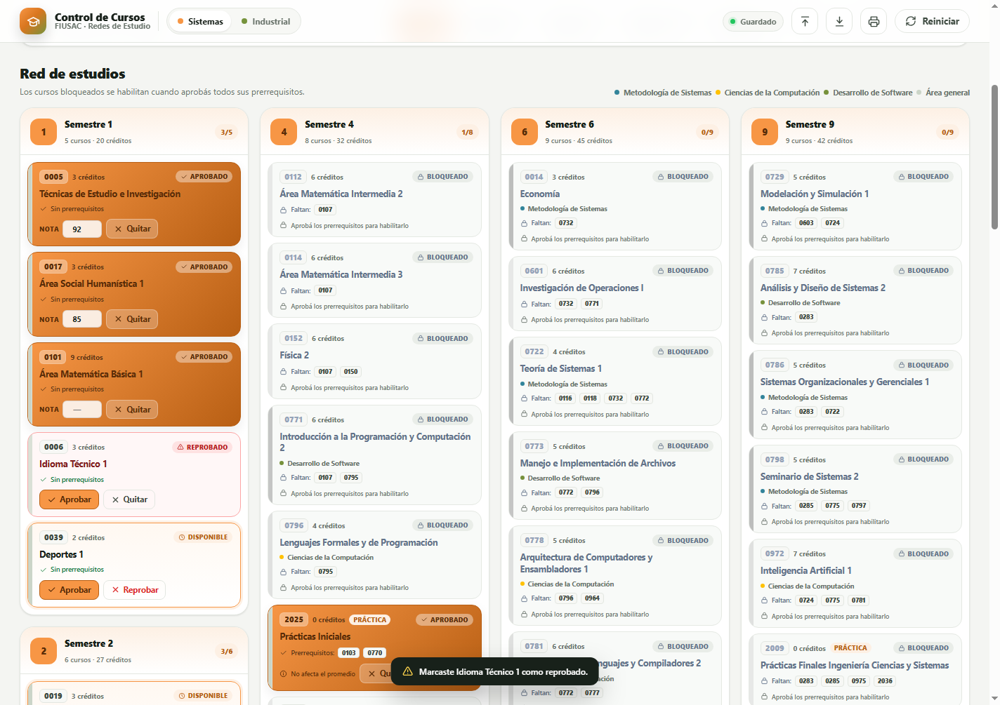
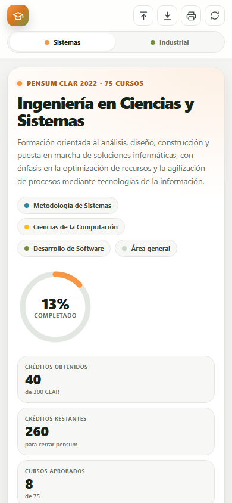

# Control de Cursos Aprobados · FIUSAC

Aplicación web para llevar el control de los cursos aprobados, disponibles y bloqueados de las redes de estudio **CLAR 2022** de:

- **Ingeniería en Ciencias y Sistemas**
- **Ingeniería Industrial**

Facultad de Ingeniería · Universidad de San Carlos de Guatemala.

> **Demo:** <https://jonathan-zamora.github.io/Control-de-Cursos-Aprobados/>  
> **Manual de usuario:** [manual.html](manual.html) · [MANUAL-DE-USUARIO.md](MANUAL-DE-USUARIO.md)



## Qué hace

- Muestra las dos redes de estudio completas, organizadas por semestre, código, créditos, área y prerrequisitos.
- Marca cada curso como **aprobado**, **disponible**, **bloqueado** o **reprobado**.
- Desbloquea automáticamente un curso solo cuando **todos** sus prerrequisitos están aprobados.
- Calcula los créditos obtenidos y los que faltan para llegar a los **300 CLAR**.
- Calcula el **promedio ponderado** con las notas de los cursos aprobados.
- Trata las prácticas de **0 créditos** como aprobadas/reprobadas, sin afectar el promedio.
- Guarda el progreso en el navegador con `localStorage`, sin cuentas ni servidores.
- Permite exportar e importar un respaldo en JSON.
- Genera un reporte imprimible o en PDF.
- Incluye búsqueda por nombre o código, filtros por estado y diseño responsive.

## Capturas

| Ingeniería en Ciencias y Sistemas | Ingeniería Industrial |
| --- | --- |
|  |  |

| Red de estudios | Vista móvil |
| --- | --- |
|  |  |

## Cómo usarla

1. Abrí la [aplicación](https://jonathan-zamora.github.io/Control-de-Cursos-Aprobados/).
2. Elegí **Sistemas** o **Industrial**.
3. Hacé clic en un curso disponible para aprobarlo, o usá los botones **Aprobar** / **Reprobar**.
4. En los cursos aprobados podés escribir la nota (0 a 100). El promedio se actualiza al instante.
5. Usá **Exportar** para descargar un respaldo y **Importar** para recuperarlo en otro navegador o dispositivo.
6. Usá **Imprimir reporte** para guardar un PDF con tu avance.

El detalle paso a paso está en el [manual de usuario](manual.html).

## Cómo funciona el desbloqueo

Cada curso tiene una lista de códigos de prerrequisitos. Un curso se habilita únicamente cuando **todos** esos códigos aparecen como aprobados.

- Los cursos de primer semestre y los que no tienen prerrequisitos están disponibles desde el inicio.
- Si falta al menos un prerrequisito, el curso queda bloqueado y muestra los códigos pendientes.
- Si un prerrequisito fue reprobado, la tarjeta lo señala con una advertencia.
- Aprobar un curso puede habilitar varios cursos a la vez; la interfaz los resalta con una animación.

## Créditos y promedio

### Créditos CLAR

La red de estudios de Sistemas suma **351 créditos** y la de Industrial **349**, pero el pensum se cierra con **300 CLAR**. Cada semestre equivale a 30 CLAR.

- **Créditos obtenidos:** suma de los créditos de todos los cursos aprobados.
- **Créditos restantes:** lo que falta para llegar a 300. Si el plan supera los 300, el indicador se detiene en 100 %.
- Las prácticas de 0 créditos no suman créditos, pero sí cuentan como cursos aprobados.

### Promedio

El promedio ponderado se calcula así:

```text
suma(nota × créditos) / suma(créditos con nota)
```

- Solo participan cursos **aprobados**, con **créditos mayores que 0** y con **nota registrada**.
- Un curso aprobado sin nota suma créditos, pero no afecta el promedio.
- Las prácticas de 0 créditos nunca afectan el promedio.
- La nota se guarda entre 0 y 100. Si es menor que 61, la aplicación muestra una advertencia, pero conserva el valor.
- También se muestra un **promedio simple** como referencia.

## Privacidad y guardado

- No hay backend, base de datos ni cuentas de usuario.
- Todo el progreso se guarda en el navegador, bajo la clave `control-cursos-fiusac:v1`.
- El progreso no se sincroniza automáticamente entre dispositivos.
- Si borrás los datos del navegador, usás modo incógnito o cambiás de navegador, el avance puede perderse. Por eso conviene **exportar un respaldo**.
- El archivo JSON exportado contiene únicamente la carrera activa, los estados de los cursos, las notas y la fecha de actualización.

## Ejecutar localmente

No hace falta instalar dependencias ni compilar nada.

**Opción 1:** clonar el repositorio y abrir `index.html` en el navegador.

```bash
git clone https://github.com/jonathan-zamora/Control-de-Cursos-Aprobados.git
cd Control-de-Cursos-Aprobados
```

**Opción 2:** levantar un servidor estático local (recomendado si el navegador bloquea archivos locales):

```bash
python -m http.server 8000
```

Luego abrir <http://localhost:8000>.

## Estructura del proyecto

```text
Control-de-Cursos-Aprobados/
├── index.html              # Aplicación principal
├── manual.html             # Manual de usuario dentro del sitio
├── favicon.svg             # Ícono del sitio
├── css/
│   ├── styles.css          # Estilos de la aplicación
│   └── manual.css          # Estilos del manual
├── js/
│   ├── data.js             # Redes de estudio, cursos, áreas y prerrequisitos
│   └── app.js              # Lógica de estados, créditos, promedio y persistencia
├── docs/capturas/          # Capturas usadas en la documentación
├── README.md
└── MANUAL-DE-USUARIO.md
```

## Datos de las redes de estudio

Los datos se tomaron de las redes de estudio oficiales del **Pensum CLAR 2022** de la FIUSAC:

- **Sistemas:** 75 cursos, 10 semestres, 351 créditos en el plan.
- **Industrial:** 77 cursos, 10 semestres, 349 créditos en el plan.
- **Meta de cierre:** 300 CLAR en ambas carreras.

Se verificó que todos los códigos de prerrequisitos existan y que el grafo no tenga ciclos.

> Esta es una herramienta de apoyo académico, no un sistema oficial de la Universidad. Ante cualquier duda sobre equivalencias, cierre de pensum o requisitos, confirmá con la Facultad de Ingeniería.

## GitHub Pages

El sitio se publica desde la rama `main`, en la raíz del repositorio:

- **Aplicación:** <https://jonathan-zamora.github.io/Control-de-Cursos-Aprobados/>
- **Manual:** <https://jonathan-zamora.github.io/Control-de-Cursos-Aprobados/manual.html>

Para reproducir la configuración en otro repositorio: **Settings → Pages → Deploy from a branch → `main` / `(root)`**.

## Contribuciones

Si encontrás un error en los datos, una nota mal calculada o un problema de accesibilidad, podés abrir un **issue** o enviar un **pull request**.

Si actualizás una red de estudio, el archivo que hay que modificar es `js/data.js`.

## Autor

**Jonathan Zamora**  
Estudiante de Ingeniería en Ciencias y Sistemas · FIUSAC  
<https://github.com/jonathan-zamora>

---

Hecho con HTML, CSS y JavaScript, sin frameworks ni dependencias.
